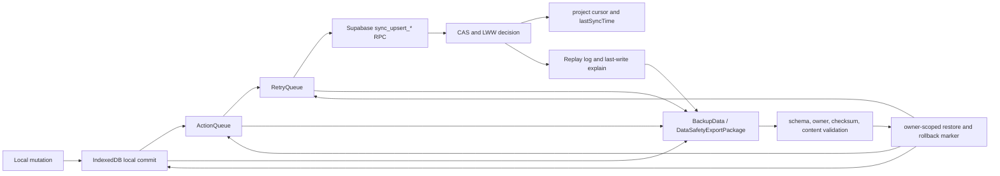

# NanoFlow Personal Data Safety Protocol

> Status: implemented loop with explicit remaining gaps; stale closed scopes reconciled
> Last verified: 2026-11-02

## 1. Safety objective

Data safety outranks feature velocity. NanoFlow data work must preserve four guarantees:

- Exportable: local entities, sync state, queues, deletion evidence, and relevant cloud state can be exported without requiring File System Access API authorization.
- Restorable: a validated package restores IDs unchanged and never guesses owner, cursor, tombstone, or task content state.
- Replayable: pending queue entries retain their original `operationId` and can be restored for deterministic replay; completed audit entries remain inspect-only.
- Explainable: the latest guarded write records actor, entity, operation, local timestamp, version baseline, queue/RPC result, LWW decision, and `lastSyncTime` effect.

The preserved architecture remains:



## 2. Current-state audit

### 2.1 Capabilities already present

| Area | Current capability | Evidence boundary |
| --- | --- | --- |
| Local-first storage | Projects, tasks, connections, metadata, and sync cursors are persisted in IndexedDB. Client entity IDs are preserved; restore never remaps IDs. | `data-safety-indexeddb-adapter.ts`, UUID-default contracts |
| State authority | `ProjectStore` is a metadata shell; task and connection arrays used by sync, durable writes, permission backup, and active-project projections are reconstructed from `TaskStore` / `ConnectionStore`. Launch and project-list metadata shells use metadata-only replacement and cannot clear authoritative entity stores. Connection-only and project-level deltas cannot replay missing tasks or stale `stage` / `parentId` values. | `ProjectStateService.getProjectWithCurrentData`, launch/metadata shell and stale-shell regressions |
| Active-project refresh and deletion safety | Queue-aware active-project refresh rechecks ActionQueue and RetryQueue state during remote load/merge and skips stale remote results when pending local writes appear. `downloadAndMerge()` no longer treats project-list omission alone as deletion authority: it preserves local projects with pending/local-only evidence and requires an explicit inaccessible project probe before pruning a synced local project. Confirmed active-project removal switches to a retained project while preserving its tasks. | `SyncCoordinatorProjectRefreshService`, `sync-coordinator.service.spec.ts`, `project-removal-active-fallback-data-safety.spec.ts` |
| Metadata snapshot durability | Project-list metadata persistence accepts empty arrays only when hydration or local mutation proves they are authoritative. Otherwise it conservatively merges a prior validated owner snapshot that contains task or connection evidence. A prior empty snapshot does not prove remote emptiness; unresolved shells abort the snapshot write and keep the deferred manifest watermark uncommitted. | `UserSessionLayer3.buildDurableProjectListMetadataSnapshot`, metadata snapshot regressions |
| Startup snapshot validation | A localStorage or IndexedDB startup candidate is validated as a complete Project/Task/Connection graph before normalization. Missing task `content`, missing required task structure, duplicate IDs, or invalid references reject the whole candidate without deleting its raw bytes. | `project-offline-snapshot-validation.ts`, offline snapshot load regressions |
| Owner isolation | Account changes and forced teardown clear Project, Task, and Connection stores together. Clearing only the project list is forbidden because entity maps are global in-memory indexes. | `UserSessionLayer1.applyOwnerChangeCleanup`, `forceClearCurrentSessionView` |
| Incremental pull | Task pulls now use `(updated_at, id)` keyset pagination, include the timestamp-only `since` boundary, and fail closed on query, tombstone, mapping, or cursor corruption. | `task-sync-query.service.ts`, `supabase-pagination.ts` |
| Durable pending work | RetryQueue, ActionQueue, dead letters, conflicts, tombstones, pending attachment blobs, and related local state can be included in `BackupData.localState`. | disaster backup reader and queue restore helpers |
| Portable export | Settings can download a JSON safety package without directory authorization, including when there are zero projects but queue or sync metadata still exists. | `LocalBackupUIService.handleDownloadDataSafetyPackage` |
| Cloud coverage disclosure | The package states `coverage.includesCloudUserState`; a failed or suspended cloud read still exports local state and explicitly marks cloud coverage incomplete. | `DisasterBackupService.buildLocalPayload` |
| Package validation | Restore checks schema shape, stable entity IDs/cursor keys, owner scope, checksum, replay-plan shape, conflict/offline-snapshot scope, cursor/tombstone timestamps, and required task `content`. Invalid packages are rejected before writes. | import conversion and data-safety package validators |
| IndexedDB restore | The canonical IndexedDB adapter validates first, writes an owner-scoped rollback marker, replaces primary stores in one transaction, restores local state, and rolls back on failure. Full-restore markers are stored in the owner-scoped IndexedDB restore-marker journal with a legacy localStorage sentinel, lease identity, ownership checks, renew/claim/clear semantics, and schema validation. Tombstones replace only package project scopes; conflicts replace only the target owner; offline snapshots restore deterministic scoped mirrors and include local-mode legacy mirrors in rollback evidence. Persisted markers are schema-validated without filtering malformed rows; corrupt markers are retained and block recovery before any write. | `restoreDataSafetyPackageToIndexedDb`, `data-safety-restore-marker-journal.ts`, `data-safety-*-restore.helpers.ts` |
| User-facing restore transaction | The settings restore validates owner, source checksum, and ActionQueue restore identity before stage writes, captures owner-scoped pre-images, and applies projects, attachment outbox, ActionQueue, RetryQueue, dead letters, conflicts, and metadata in that order. Each stage computes an independent target or semantic verifier before writing, drains and reads back durable state before progress is recorded, and rejects a stable stale read as failure; failures compensate in reverse order. An owner-scoped journal and writer quiescence fence coordinate the UI and session startup. Startup takes over only matching expired owner/run/queue/quiescence evidence; mismatches fail closed without writes. Failed compensation retains the journal and keeps writers frozen. Terminal finalization errors preserve completed/rolled-back evidence for startup cleanup instead of starting another stage rollback. When preparation cannot prove that its journal was removed, it stops heartbeating and retains matching quiescence evidence until startup recovery can take over. RetryQueue read-back rejects duplicate records within either storage while permitting cross-storage mirrors. Entity IDs and `operationId` remain stable, and metadata merge does not regress cursors or tombstones. | `local-backup-ui-restore-transaction.service.ts`, `local-backup-ui-restore-stage-protocol.ts`, `local-backup-ui-restore-stage.service.ts`, `local-backup-ui-restore-startup-recovery.service.ts`; journal, pre-image, stage, rollback, startup, fence, settings, and session specs |
| Metadata restore | Project cursors, `lastSyncTime`, replay log, last-write explain, and task/connection tombstones restore through a compensating rollback marker. Rollback replaces tombstones only for touched projects and preserves concurrent entries for other projects; empty or malformed markers fail closed and remain available for diagnosis. Cursor and tombstone timestamps never regress. | `BackupDataSafetyMetadataRestoreService`, `backup-data-safety-metadata-restore.service.spec.ts` |
| Queue replay | Restored RetryQueue and ActionQueue entries keep `operationId`; duplicate entries are deduplicated, and normal queue runners replay them. | queue restore helpers and RetryQueue replay tests |
| Write audit | Guarded sync RPC writes, realtime/upsert paths, and RPC delete paths persist a bounded owner-scoped replay log and latest write explanation. RPC-unavailable or client-rejected paths defer or queue the durable intent instead of falling back to unaudited direct REST writes. The two formerly open non-RPC scopes are also settled: offline snapshot replacement records one owner-scoped audit only after at least one localStorage/IndexedDB mirror is saved, including both mirror outcomes; sync-RPC-unavailable local task deletion records one audit per task only after local tombstones and dependent state settle and every durable retry intent queues. Persistence failure is reported but does not retroactively fail a completed data write. This is an exact scoped closure, not a claim that every local mutation path in the product has been globally audited. | `DataSafetyWriteAuditService`; `project-offline-snapshot.service.ts` with `project-data-offline-snapshot.spec-helpers.ts` through `project-data.service.spec.ts`; `task-sync-delete.service.ts` and `task-sync-delete.helpers.ts` with `task-sync-operations-delete-rpc.spec-helpers.ts` through `task-sync-operations.service.spec.ts`; RPC upsert/delete audit specs |
| Flow topology drag/drop | Full unassigned drops resolve the dragged task from `DataTransfer` and the target task from the actual `[data-unassigned-task-id]` drop card. Blank, self, deleted, or assigned-card targets do not mutate parent topology. | `FlowDragDropService.resolveDroppedTask`, `FlowDragDropService.resolveUnassignedDropTarget`, `flow-drag-drop.service.spec.ts` |
| LWW diagnostics | `sync_upsert_task` now reports comprehensive `changed_fields` for all persisted task fields, including `content`, structure, collections, parking, and attention metadata. | `20260715017000_sync_upsert_task_explainability.sql` |
| Migration gate | Migrations are classified as transaction-safe or explicit-risk. Risk migrations require an export and written rollback strategy; transaction-safe migrations produce a savepoint/rollback dry-run plan. | `quality:guard:migration-dry-run` |

The user-facing restore transaction received a verification refresh on 2026-11-02: 21 related spec files passed serially (442/442 tests), `npm run typecheck` passed, and `git diff --check` passed. `npm ci` remains blocked because `package.json` requires `@emnapi/wasi-threads@1.2.3` while the lockfile records `1.2.2`; verification used `npm install --package-lock=false` in an isolated worktree without changing the lockfile. This evidence closes only the restore transaction scope described above; the remaining data-safety groups stay open.

Terminal cleanup also performs a second durable ActionQueue receipt read-back before clearing the restore journal. A mismatch retains the journal and defers the quiescence heartbeat so startup can take over only after the lease expires.

### 2.2 Remaining gaps

Only the four gaps below remain. The user-facing restore transaction and the previously listed offline-snapshot replacement and sync-RPC-unavailable local task-deletion audit gaps are closed for the exact scopes and evidence named in section 2.1; the other data-safety groups remain open.

1. RetryQueue and ActionQueue steps are executable replay. Historical audit-only steps are deliberately inspect-only to avoid duplicating already-applied writes.
2. `coverage.includesCloudUserState=false` is an honest partial export, not a complete cloud backup. Already-uploaded Supabase Storage attachment binaries are not all embedded; pending local upload blobs are embedded.
3. Downloaded JSON packages are plaintext. Checksums detect corruption, not unauthorized disclosure or malicious replacement. Optional package encryption/signing is not yet implemented.
4. `DataSafetyExportPackage.integrity.checksum` is deterministic corruption detection; the outer `BackupData.checksum` uses SHA-256. Neither is an authenticity signature.

## 3. Export package schema

### 3.1 User-facing package

The settings workflow exports `BackupData` version `2.0.0`:

```json
{
  "version": "2.0.0",
  "payloadVersion": "2.0.0",
  "type": "full",
  "createdAt": "ISO-8601",
  "checksum": "sha256",
  "coverage": {
    "includesProjectData": true,
    "includesCloudUserState": true,
    "includesLocalState": true
  },
  "tableCounts": {},
  "projects": [],
  "tasks": [],
  "connections": [],
  "userPreferences": [],
  "blackBoxEntries": [],
  "focusSessions": [],
  "transcriptionUsage": [],
  "routineTasks": [],
  "routineCompletions": [],
  "localState": {
    "retryQueue": [],
    "actionQueue": {},
    "deadLetters": [],
    "conflicts": [],
    "taskTombstones": {},
    "connectionTombstones": [],
    "attachmentUploadOutbox": [],
    "dataSafety": {
      "schemaVersion": "1.0.0",
      "exportedAt": "ISO-8601",
      "ownerUserId": "uuid-or-local-owner",
      "syncSnapshot": {},
      "replayLog": [],
      "replayPlan": {},
      "lastWriteExplain": null
    }
  }
}
```

Hard validation rules:

- IDs are restored exactly as exported. `idRemappingRequired` must remain `false`.
- Every task restored into NanoFlow must contain string `content`; missing `content` rejects the package.
- Queue entries that can execute must contain a stable `operationId` and owner scope.
- Cursor and tombstone timestamps must parse. User-facing merge restore must not regress current watermarks; canonical snapshot restore replaces the imported project scope exactly and preserves unrelated projects.
- Package owner must equal the active owner, except explicit local-only owner handling.
- `coverage` is descriptive evidence. It must never be silently upgraded from `false` to `true` during restore.

### 3.2 Canonical local protocol package

`DataSafetyExportPackage` schema `1.0.0` is the lower-level IndexedDB protocol:

```ts
interface DataSafetyExportPackage {
  schemaVersion: '1.0.0';
  exportedAt: string;
  ownerUserId: string;
  app: {
    appVersion: string;
    syncProtocolVersion: number;
    deploymentEpoch: number;
    deploymentTarget?: string | null;
  };
  localData: {
    projects: EntityRecord[];
    tasks: EntityRecord[];
    connections: EntityRecord[];
    syncCursors: CursorRecord[];
    meta?: unknown;
  };
  localState: {
    retryQueue: RetryQueueItem[];
    actionQueue: QueuedAction[];
    deadLetters: DeadLetterItem[];
    conflicts: unknown[];
    taskTombstones: Record<string, Record<string, number>>;
    connectionTombstones: Array<{
      projectId: string;
      id?: string;
      connectionId?: string;
      timestamp: number;
    }>;
    offlineSnapshots?: {
      localStorage?: string | null;
      indexedDb?: string | null;
    } | null;
  };
  syncSnapshot: SyncSnapshot;
  replayLog: ReplayEntry[];
  replayPlan: ReplayPlan;
  lastWriteExplain: LastWriteExplain | null;
  integrity: { tableCounts: Record<string, number>; checksum: string };
}
```

## 4. Restore protocol

### 4.1 Required order

1. Parse JSON without writing data.
2. Validate schema version, outer checksum, canonical checksum, table shape, task `content`, owner, queue operation IDs, replay plan, cursors, and tombstones.
3. Build a dry-run preview with entity and local-state counts. Display incomplete cloud coverage explicitly.
4. Confirm the active owner and freeze the restore generation. Any owner/session change aborts the run.
5. Capture rollback evidence before the first mutation:
   - primary IndexedDB stores and metadata;
   - current queue/dead-letter state;
   - owner-scoped conflict IndexedDB rows and fallback keys;
   - scoped offline snapshot mirrors plus local-mode legacy mirrors;
   - cursor rows, `lastSyncTime`, exact raw tombstone storage values, and audit log;
   - owner-scoped restore marker with timestamp and touched project IDs.
6. Restore primary local entities without ID remapping.
7. Restore pending attachment uploads, ActionQueue, RetryQueue, dead letters, conflicts, offline snapshots, and tombstones with owner/project filtering and operation-ID deduplication.
8. Restore cursors, `lastSyncTime`, replay log, and last-write explain using monotonic merge rules where the protocol is a merge rather than an exact snapshot restore.
9. Reload tombstone caches before making restored entities visible to sync.
10. Clear the restore marker only after every stage succeeds.
11. On failure, compensate in reverse dependency order. If any rollback step fails, retain the marker and report the exact failed stage. Startup recovery must retry from the marker before normal persistence resumes.
12. Treat a persisted marker as a journal, not advisory cache. Invalid JSON, owner/schema mismatch, malformed primary rows, or malformed queue/local-state snapshots must return an explicit validation error, retain the original marker bytes, and perform zero recovery writes. Only an absent marker may produce a clean `recovered: false` result.

### 4.2 Idempotency rules

- Re-restoring the same package produces `skip` or an equivalent no-op for identical records.
- Queue identity is `operationId`, not array position.
- Replay audit identity is `operationId`; retain at most the configured recent window.
- User-facing cursor and tombstone merges use max timestamp semantics.
- Canonical local snapshot restore replaces tombstones for package project IDs and preserves tombstones for all other project IDs.
- Canonical conflict restore replaces only the package owner and preserves every other owner.
- Canonical offline snapshot restore rejects divergent mirrors, writes one validated payload to both scoped mirrors, and removes stale local-mode legacy mirrors only after they are captured for rollback.
- `lastSyncTime` may restore only to an equal or newer valid timestamp for the same owner.
- Restore never generates replacement entity IDs.

### 4.3 Startup snapshot materialization

- Treat localStorage and IndexedDB payloads as untrusted serialized state. Parse and validate the complete candidate before calling any normalizer or Store method.
- Project, task, and connection IDs must be non-empty and globally unique for their entity type. Task `content` is required as a string; empty string is valid, a missing field is not.
- Required task topology and layout fields must be present with valid runtime types. Parent and connection endpoints must remain inside the same project.
- Validation is atomic per candidate. Do not filter malformed records or synthesize missing fields. A malformed preferred candidate may fall back to a separately valid alternate mirror, but it must never be partially materialized.
- Preserve rejected raw bytes. Failure to materialize is not authority to delete the only forensic/exportable copy.
- Project-list metadata persistence follows the same proof rule: hydrated or locally changed entity state is authoritative; otherwise conservatively merge a validated owner-scoped durable snapshot with task or connection evidence. A prior empty snapshot is not deletion/emptiness authority. If no entity evidence exists, skip persistence and leave the manifest watermark pending until hydration establishes a safe snapshot.
- Owner transitions call `ProjectStateService.clearData()` so project shells and global task/connection indexes cannot cross account boundaries.

## 5. Replay protocol

Replay steps are sorted by:

1. `localTimestamp` ascending;
2. source rank: audit log, ActionQueue, RetryQueue;
3. `operationId`;
4. entity type and ID.

Each step contains:

```ts
interface ReplayPlanStep {
  source: 'retryQueue' | 'actionQueue' | 'auditLog';
  operationId: string;
  entityType: string;
  entityId: string;
  operation: string;
  replayable: boolean;
  reason: string;
  localTimestamp: number;
  updatedAtBaseline?: string | null;
  retryCount: number;
  queue: QueueResult;
  rpc: RpcSnapshot;
  lww: LwwDecision;
  lastSyncTime: LastSyncTimeEffect;
}
```

Execution policy:

- `retryQueue` and `actionQueue`: replayable after restore through their existing runners.
- `auditLog`: inspect-only. Re-execution requires a fresh explicit user mutation and new `operationId`.
- Replay must preserve the exported `operationId`; no random replacement is allowed.
- An operation-ID/payload-digest mismatch is terminal and must never be treated as idempotent success.

## 6. Last-write explanation

```json
{
  "operationId": "uuid",
  "actor": { "sourceUserId": "uuid" },
  "entity": { "type": "task", "id": "uuid" },
  "operation": "upsert",
  "localTimestamp": 1781539200000,
  "updatedAtBaseline": "2026-07-15T00:00:00.000Z",
  "beforeVersion": "2026-07-15T00:00:00.000Z",
  "afterVersion": "2026-07-15T00:00:02.000Z",
  "queueResult": {
    "enteredRetryQueue": false,
    "retryCount": 0,
    "deadLettered": false
  },
  "rpcResult": {
    "status": "remote-newer",
    "reason": "stale_task_payload",
    "remoteUpdatedAt": "2026-07-15T00:00:02.000Z",
    "raw": {
      "changed_fields": ["content", "status", "order", "attachments"]
    }
  },
  "lwwDecision": {
    "decision": "remote-kept",
    "reason": "remote-newer"
  },
  "lastSyncTime": {
    "before": "2026-07-15T00:00:01.000Z",
    "after": "2026-07-15T00:00:01.000Z",
    "advanced": false
  },
  "conflict": {
    "status": "conflict-detected",
    "reason": "remote-newer",
    "localSnapshot": {},
    "remoteSnapshot": {}
  }
}
```

Interpretation rules:

- `local-applied`: server accepted the local version.
- `remote-kept`: LWW/CAS rejected a stale local write.
- `idempotent-replay`: the same operation ID and payload digest returned the stored result.
- `blocked`: protocol, authorization, or quarantine prevented the write.
- `lastSyncTime.advanced` is evidence, not an instruction to advance it during replay.

## 7. Migration dry-run and rollback

Every migration changing storage, RPCs, sync fields, RLS, or ownership must produce deterministic evidence:

1. Export a safety package before any destructive or explicit-transaction migration.
2. Record package checksum, coverage flags, table counts, queue counts, owner, latest cursor, and latest write explanation.
3. Capture `pg_get_functiondef`, grants, policies, and relevant table definitions before `CREATE OR REPLACE`, RLS, or schema changes.
4. Run the migration on a disposable Supabase branch or local clone.
5. For transaction-safe migrations, execute in a savepoint and `ROLLBACK TO SAVEPOINT` after validation.
6. For `BEGIN/COMMIT`, concurrent index, vacuum, or destructive rewrites, declare the migration in `migration-dry-run-manifest.json` with `requiresDataSafetyExport=true` and an exact rollback strategy.
7. Validate after dry-run:
   - no entity UUID default was introduced;
   - task payload and persisted row still include `content`;
   - row counts and owner counts are unchanged unless explicitly planned;
   - queue operation IDs and payload digests remain stable;
   - cursors and `lastSyncTime` did not regress;
   - RPC status vocabulary, grants, locked `search_path`, and LWW guards remain intact.
8. Rollback uses captured definitions or the transaction rollback, followed by the same validation queries. A human must never infer the old function body or data counts from memory.

The task explainability migration is additive and transaction-safe. It redefines the public wrapper, preserves the June 2026 payload-digest replay guard, and updates the stored operation-log result with comprehensive `changed_fields`.

## 8. Verification evidence

Historical baseline commands run on 2026-07-15 (prior broad evidence, not current verification status):

```text
npx vitest run --config vitest.config.mts src/services/disaster-backup.service.spec.ts --maxWorkers=1 --no-file-parallelism
PASS: 1 file, 10/10 tests

npx vitest run --config vitest.config.mts src/services/disaster-backup-local-state.reader.spec.ts --maxWorkers=1 --no-file-parallelism
PASS: 1 file, 3/3 tests

npx vitest run --config vitest.config.mts src/app/core/services/sync/project-data.service.spec.ts --maxWorkers=1 --no-file-parallelism
PASS: 1 file, 46/46 tests

npx vitest run --config vitest.config.mts src/services/data-safety-indexeddb-adapter.spec.ts --maxWorkers=1 --no-file-parallelism
PASS: 1 file, 29/29 tests

PowerShell data-safety matrix command (74 serial files after isolating IndexedDB-heavy suites):
$patterns = @(
  'src/services/data-safety*.spec.ts',
  'src/services/backup-data-safety*.spec.ts',
  'src/services/import-backup-data-safety*.spec.ts',
  'src/services/import-backup-conversion.helpers.spec.ts',
  'src/services/disaster-backup-blob.helpers.spec.ts',
  'src/services/disaster-backup-local-state.helpers.spec.ts',
  'src/services/disaster-backup-payload.helpers.spec.ts',
  'src/services/local-backup*.spec.ts',
  'src/app/shared/modals/settings-modal/local-backup-ui*.spec.ts',
  'src/app/core/services/sync/retry-queue*.spec.ts',
  'src/services/action-queue-restore*.spec.ts',
  'src/services/action-queue-owner*.spec.ts',
  'src/services/action-queue.service.spec.ts',
  'src/app/core/services/simple-sync*.spec.ts',
  'src/app/core/services/sync/task-sync-operations.service.spec.ts',
  'src/app/core/services/sync/task-sync-delete.helpers.spec.ts',
  'src/app/core/services/sync/task-sync-push*.spec.ts',
  'src/app/core/services/sync/connection-sync-operations*.spec.ts',
  'src/app/core/services/sync/sync-state.service.spec.ts',
  'src/services/sync-coordinator*.spec.ts',
  'src/services/remote-change-handler*.spec.ts',
  'src/services/project-state-data-safety.spec.ts',
  'src/services/user-session.service.spec.ts',
  'src/app/core/services/sync/project-data.service.spec.ts',
  'src/services/conflict-resolution.service.spec.ts',
  'src/services/migration-integrity*.spec.ts',
  'src/services/task-move.helpers.spec.ts',
  'src/app/core/services/sync/tombstone.service.spec.ts'
)
$files = foreach ($pattern in $patterns) { Get-ChildItem -Path $pattern -File -ErrorAction SilentlyContinue }
$exclude = @(
  (Resolve-Path 'src/app/core/services/sync/project-data.service.spec.ts').Path,
  (Resolve-Path 'src/services/data-safety-indexeddb-adapter.spec.ts').Path
)
$paths = $files.FullName | Sort-Object -Unique | Where-Object { $_ -notin $exclude }
& npx vitest run --config vitest.config.mts --maxWorkers=1 --no-file-parallelism @paths

Coverage: export, restore, replay, explain, RetryQueue, ActionQueue, SimpleSync, LWW, tombstones, metadata shells, owner isolation, and migration integrity
PASS: 74/74 files; 1284 tests passed, 66 explicitly skipped
Combined data-safety evidence: 78 files; 1372 tests passed, 66 explicitly skipped

npm run typecheck
PASS

npm run lint
PASS: 0 errors, 0 warnings

npm run build:dev -- --configuration development --output-path dist/data-safety-verify
PASS

npm run quality:guard:migration-dry-run
PASS: 163 migrations checked; 147 transaction-safe; 16 require data-safety export

npm run docs:human:guard
PASS: 36 handbook pages checked; coupled-change guard passed

git diff --check
PASS

npx vitest run --config vitest.config.mts <offline-first, local-first, LWW, replay-digest, stale-write, and task explainability contracts>
PASS: 6/6 files; 28/28 tests

Historical note: the 2026-07-15 broad `test:contracts` and `codegraph:overlay:docs:validate` failures are not current data-safety gap evidence in this protocol. This 2026-07-27 document-only reconciliation did not run full/minimal gates or overlay sync by coordinator scope.
```

Rendered Playwright QA also passed on a fresh development build at `1440x1000` and `390x844`:

- downloaded a real `BackupData` JSON package;
- verified `coverage`, owner-scoped `localState`, and `localState.dataSafety`;
- loaded the same file into restore preview and completed an idempotent restore;
- verified mobile `菜单 -> 设置` access, no horizontal overflow, no framework overlay, and no console, page, request, or HTTP failures.

Coordinator-provided implementation evidence reviewed through CodeGraph on 2026-07-27 (scoped evidence from the implementation runs, not fresh broad global gates from this document-only reconciliation):

- Offline snapshot audit: `ProjectOfflineSnapshotService.persistOfflineSnapshot()` in `src/app/core/services/sync/project-offline-snapshot.service.ts` records one `offline-snapshot` / `replace` audit after storage settlement and records `localStorage` and `indexedDB` as `saved` or `failed`. `src/app/core/services/sync/project-data-offline-snapshot.spec-helpers.ts`, executed by `src/app/core/services/sync/project-data.service.spec.ts`, asserts the owner-scoped replay/explain record after both mirrors save and asserts no audit before or after an unsettled failed write. RED: 2 failures before implementation. GREEN: 46/46. The implementation run's typecheck, ESLint, and scoped diff check were green.
- Local task-delete audit: `TaskSyncDeleteService.preserveSoftDeleteTasksForRetry()` in `src/app/core/services/sync/task-sync-delete.service.ts` adds tombstones, settles deleted-task dependencies, queues every retry intent, and only then calls `recordSettledLocalTaskDeleteWriteAudit()` in `src/app/core/services/sync/task-sync-delete.helpers.ts`; that helper records one owner-scoped `task` / `delete` audit per task with deterministic child operation IDs for a batch. `src/app/core/services/sync/task-sync-operations-delete-rpc.spec-helpers.ts`, executed by `src/app/core/services/sync/task-sync-operations.service.spec.ts`, asserts the settled audit and asserts `lastWriteExplain: null` plus an empty replay log when durable queueing does not settle. RED: the expected audit was null before implementation. GREEN: 109/109. The implementation run's typecheck, ESLint, and scoped diff check were green.
- These results close only the two named non-RPC audit scopes. They do not refresh the historical broad data-safety matrix, full/minimal gates, overlay validation, build, or repository-wide typecheck/lint status.

Earlier bounded reconciliation commands run on 2026-07-27:

```text
npx vitest run --config vitest.config.mts src/services/project-removal-active-fallback-data-safety.spec.ts src/services/sync-coordinator.service.spec.ts src/app/features/flow/services/flow-drag-drop.service.spec.ts src/services/data-safety-write-audit.service.spec.ts src/services/data-safety-restore-marker-journal.spec.ts
PASS: 5/5 files; 162/162 tests

npm run docs:human:guard
PASS: 36 handbook pages checked; human-docs coupled-change guard passed

git diff --check -- docs/personal-data-safety-protocol.md
PASS
```

Final non-RPC audit-gap document reconciliation commands run on 2026-07-27:

```text
npm run docs:human:guard
PASS: 36 handbook pages checked; human-docs coupled-change guard passed

git diff --check -- docs/personal-data-safety-protocol.md
PASS
```
